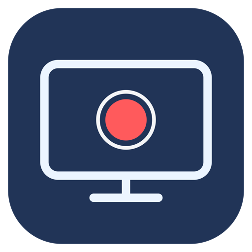

# Screen Recorder for macOS

A small native Mac app that records your main screen and computer sound to an MP4. Built with SwiftUI and Apple's ScreenCaptureKit; no third-party runtime dependencies or virtual audio drivers.



## Features

- Start Recording and Stop & Save buttons
- Recording status and elapsed time
- Open Recordings and Play Latest buttons
- Computer audio included; microphone off
- Recorder controls excluded from captured screen
- H.264 video, up to 1920 pixels wide at 30 fps, with stereo AAC audio
- Recordings saved in `~/Movies/Screen Recordings`

## Requirements

macOS 15 or later. Build using Apple's Command Line Tools with a macOS 15 or newer SDK. The downloadable app is for Apple Silicon; the build script builds for the current Mac's architecture.

## Download and use

Download the app ZIP from [Releases](../../releases), extract it, and open **Screen Recorder.app**. You can move it to Applications.

This personal build is ad-hoc signed and is not notarized by Apple. macOS may require approval through System Settings → Privacy & Security before opening a downloaded copy.

1. Click **Start Recording**.
2. Allow screen and system audio recording when macOS asks.
3. If access is denied, click **Open Permissions**, enable Screen Recorder under **Privacy & Security → Screen & System Audio Recording**, then quit and reopen the app. Ad-hoc signed builds can be treated as a different app by macOS after rebuilding or replacing the app. If switching permission off and on does not help, quit Screen Recorder completely, run the following command in Terminal, then reopen the app and approve access again:

   ```sh
   tccutil reset ScreenCapture se.bergsland.screenrecorder
   ```

   This resets only this app's screen recording approval.
4. Click **Stop & Save** to finish.

The app records the main display. There is currently no display/window/region selector, microphone option, pause button, or global stop shortcut. Protected content may not be captured.

## Build

```sh
xcode-select --install # only if Apple's Command Line Tools are missing
./build.sh
open "build/Screen Recorder.app"
```

## Source

- `Sources/ScreenRecorderApp.swift`: interface and recording implementation
- `Resources/`: app metadata and icon assets
- `Sources/MakeIcon.swift`: icon-generation source; run from the repository root with `work/ScreenRecorder.iconset` created, then use `iconutil` to produce the ICNS

## Validation

The graphical app was tested on macOS 26.5.1: recording started, Stop & Save completed, and the resulting approximately nine-second MP4 was verified to contain 1728 × 1116 H.264 video and stereo 48 kHz AAC audio. Screen recording permission was recovered after an app rebuild by resetting this app’s ScreenCapture approval and approving it again.
